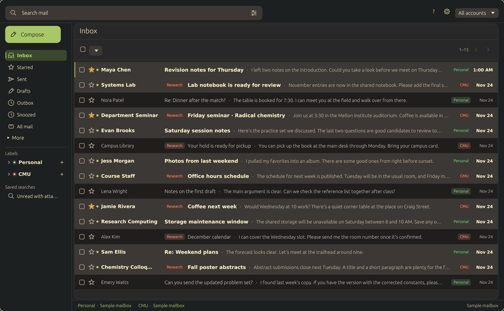
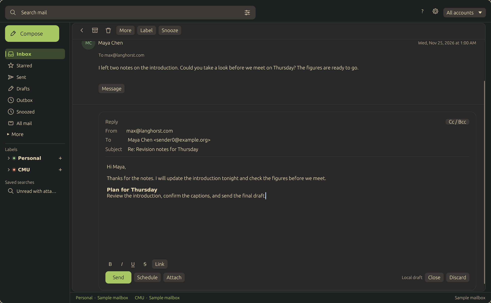

# Tandem Mail

Keyboard-first Gmail on the Linux desktop. Built with Rust and egui, with a local SQLite mailbox and Gruvbox light and dark themes.



Browse multiple Gmail accounts together, search downloaded mail offline, and reply without leaving the thread. Tandem keeps mail and attachments locally while Gmail handles delivery and server-side filters.

## What it does

- Unified inbox with account-specific folders, labels, saved searches, and bulk actions.
- Offline full-text search with Gmail-style operators, plus live Gmail search.
- Rich-text replies with bold, italics, underline, and custom links. Drafts and attachments autosave locally.
- Ten-second send undo, local scheduling and snooze, and keyboard navigation throughout.
- Native reading for everyday mail and an isolated Brave renderer for designed HTML messages.
- Optional AI reply drafting through a signed-in Codex CLI, with a chance to review every reply.
- A local MCP server for searching and reading cached mail. Sending requires an explicit flag.



Screenshots use the disposable sample mailbox, with fictional messages.

## Try it

Tandem is an early desktop project developed on NixOS and Wayland. Account setup currently requires existing Google OAuth credentials; there is no built-in sign-in flow or packaged download.

With Nix installed:

```sh
git clone https://github.com/maxlang7/tandem-mail.git
cd tandem-mail
nix-shell --run 'cargo run --locked -j 3 -- --demo'
```

The demo uses an in-memory mailbox and does not connect to Gmail. To use real mail, configure accounts below, then run:

```sh
nix-shell --run 'cargo run --locked -j 3'
```

The shell supplies Rust, build tools, graphics libraries, and a bold font. HTML mail rendering also needs Brave available on `PATH`. Other Linux distributions need the equivalent Wayland or X11, OpenGL, D-Bus, and keyboard libraries. Platforms other than Linux are untested.

To prepare the local release launcher:

```sh
nix-shell --run 'CARGO_BUILD_JOBS=3 ./scripts/launch.sh --prepare'
./scripts/launch.sh
```

Use `--check-accounts` to verify account access without starting mailbox sync.

### Account setup

The default setup picks up the local Google Workspace OAuth credentials for
`max@langhorst.com` and `mlanghor@andrew.cmu.edu`. Tandem Mail verifies the
Google profile email before reading or writing a mailbox. It uses the existing
refresh tokens in place and keeps access tokens in memory. Settings shows the
connection status for each account.

For other Gmail accounts, put an `accounts.json` file in the cache directory.
Use a unique, stable ID per account and an absolute credentials path.

```json
[
  {
    "id": "work",
    "name": "Work",
    "email": "you@example.com",
    "credentials": "/absolute/path/to/authorized-google-credentials.json"
  }
]
```

The credentials JSON needs `client_id`, `client_secret`, and `refresh_token`.
Your OAuth grant needs Gmail read access, modify and send access for mailbox
actions and sending, and Gmail settings access for server-side filters.

## Mail and search

- Browse threads, categories, starred mail, labels, drafts, spam,
  and Trash. Expand an account under Labels to browse its labels. The plus
  button beside each account opens the label editor for that account. Select
  multiple threads to archive, label, move, or mark them.
- Enter a search for local results. Use **Search Gmail** to query both Gmail
  servers or use Gmail operators outside the local search syntax. The advanced
  search form can build a query and run it either way.
- Offline search supports terms, quoted phrases, exclusions with `-`, explicit
  `AND` and `OR`, parentheses, and Gmail-style OR groups in braces. It supports
  `from:`, `to:`, `cc:`, `bcc:`, `subject:`, `filename:`, `label:`,
  `category:`, `account:`, `rfc822msgid:`, `in:`, `is:`, `has:attachment`,
  `has:userlabels`, `after:`, `before:`, `newer_than:`, `older_than:`,
  `larger:`, and `smaller:`. For example,
  `{from:library@example.org subject:"lab notebook"} is:unread -label:receipts`.
- Save a frequently used local query from its results. Use **Settings → Gmail
  filters** to list, create, duplicate, and delete account-specific rules that Gmail applies to new
  mail. The rule editor supports Gmail search terms, exclusions, addresses,
  filenames via query syntax, attachments, and size. Actions include labeling,
  skipping the inbox, marking read, starring, spam handling,
  categorizing, and forwarding to an address already verified in Gmail.
- Compose, forward, reply, or reply all with attachments and rich-text formatting. Use Ctrl+B, Ctrl+I, and Ctrl+U for bold, italics, and underline, or Ctrl+K to insert a link with custom text. Drafts and their file
  bytes autosave locally. Gmail drafts are readable and can be copied into a
  local draft. Send queues a message with ten seconds to undo it. Schedule and
  snooze are local to Tandem Mail. Scheduled messages send when due while
  the app is running, or the next time it opens.
- To, Cc and Bcc suggest recently contacted addresses from the sending account.
  Use ↑/↓ and Enter or Tab to pick a complete address.
- Open a thread and press **Shift+R** to draft with GPT-6 Luna through the
  signed-in local `codex` command. Luna can request searches of the current
  account's cache and mimic your style from recent sent mail or pasted samples.
  Review and edit the reply before copying it or opening it in the composer.
- Click a cached attachment to choose its destination in the desktop folder
  picker, which uses Yazi on Aragorn. **Download all** saves every attachment in
  the message to the same folder. Right-click and choose **Save to Downloads**
  for a quick save. The **Message** menu can also export the original `.eml`.
- The reader uses Gruvbox for ordinary messages and Brave for designed emails such
  as Ed notifications. Use the **Message** menu to switch views or restore Auto
  for an individual message. Public remote images load automatically in the
  background and remain available offline after downloading. The reader hides
  known tracking pixels. A remote server can still learn when Tandem fetches an
  image from it.
- Rich mail reuses one isolated Brave renderer, pauses it between jobs, and
  closes it after 15 seconds without work. Lossless captures preserve text,
  inline images, and clickable link geometry. Finished captures also live in a
  separate `render-cache.sqlite` beside the mailbox, with a 128 MiB data budget
  and at most 256 entries. SQLite can retain up to one extra entry's allocated
  space for reuse. Content, image, width, and density changes invalidate a
  capture. Cache failures fall back to rendering the message.

### Rendering benchmark

The offline benchmark generates short notifications, long newsletters, and
high-density messages. It never reads the mailbox or downloads images.

```sh
nix-shell --run 'cargo build --release --locked -j 3'
python3 scripts/measure-render.py target/render-fresh target/release/tandem-mail 8
python3 scripts/measure-render.py target/render-cached target/release/tandem-mail 8 cached
```

Fresh mode changes the document each round and includes browser startup in its
first sample. Cached mode seeds each fixture before timing disk-cache reads;
it includes MIME parsing, PNG decoding, and geometry restoration. These timings
end before GPU texture upload and do not include network image downloads.
Cached mode's total CPU measurement includes the untimed seed renders.
JSON reports contain all samples, medians, sampled process-tree CPU time, and
summed peak RSS. RSS counts shared memory in each process. CPU time is sampled
every 5 ms and may miss short-lived work. Package energy is included only when
the Linux RAPL counter is readable. CPU time alone does not prove equal wattage.
Use `TANDEM_BENCH_IDLE=20` to keep the process alive after the benchmark for
checking idle CPU use and renderer shutdown.

## Keyboard shortcuts

| Keys | Action |
| --- | --- |
| `j` / `k` or arrow keys | Move through threads |
| `o` / Enter | Open thread |
| `u` / Esc | Return to the list |
| `x` / Ctrl+A | Select thread / select page |
| `/` or Ctrl+F | Search |
| Ctrl+K | Command menu |
| Ctrl+R | Refresh |
| `c` | Compose |
| `e` / `#` | Archive / move to Trash |
| `s` | Toggle star |
| Shift+U / Shift+I | Mark unread / read |
| `r` / `a` / `f` | Reply / reply all / forward |
| `Shift+R` | Draft a reply with Luna |
| Ctrl+Enter / Ctrl+Z | Queue send / undo queued send |
| `g i` | Open or refresh Inbox |
| `g n` | Open the CMU NMRs label |
| `g a`, `g s` | All mail, starred |
| `g d`, `g t`, `g u` | Drafts, sent, unread |
| `?` | Keyboard shortcuts |

## Local cache

The cache defaults to `${XDG_DATA_HOME:-~/.local/share}/tandem-mail/mail.sqlite`.
Set `TANDEM_MAIL_DIR` to use a different owner-only directory. The database
contains plaintext mail, indexed text, raw MIME with attachment bytes, drafts,
and the outbox. Keep this directory private. It can grow to the size of both
mailboxes plus the search index.

The first sync works through every Gmail message page, including spam and Trash,
and resumes from a checkpoint after closing and reopening the app. Mail becomes
available as it downloads. Gmail rate limits can pause the first download.
Tandem Mail keeps its place and retries automatically. While Tandem Mail is open,
each account checks Gmail at startup and every five minutes. It uses [Gmail history](https://developers.google.com/workspace/gmail/api/guides/sync)
to fetch changes and starts a fresh scan when Gmail expires the cursor. Cached
mail and attachment downloads remain available when the network is offline.
Messages that disappear from Gmail are removed from normal views and their
original bytes are retained in the database.

## Model Context Protocol

Run the built `tandem-mail` binary with `--mcp` as a stdio server. It reads the
existing local cache, even when the desktop app is closed. The app still does
Gmail sync, so check `list_accounts` for the last successful refresh. The server
starts in read-only mode. Add `--account home` or `--account cmu` to limit a
client to one mailbox. Use a client you trust with the selected mail.

For Codex, pass the absolute path to your release binary:

```sh
codex mcp add tandem-mail -- /path/to/tandem-mail/target/release/tandem-mail --mcp
```

| Tool | Result |
| --- | --- |
| `list_accounts` | Enabled account IDs, last sync, and backfill progress |
| `list_labels` | Cached labels for one account |
| `search_threads` | Gmail-style search or inbox results, including read state |
| `read_thread` | Message IDs, headers, previews, and attachment indices |
| `read_message` | Plain-text message body with Unicode-safe paging |
| `read_attachment` | UTF-8 text or base64 chunks from a cached attachment |
| `send_mail` | Send a plain-text message via Gmail and return its Gmail message ID. Requires `--allow-send`. |

Use the `account` value alongside thread and message IDs. If a result has a
`next_offset`, pass it with the same tool arguments to get the next page.
Search pages may move as the desktop sync updates the cache.

To enable sending for the Personal account in a separate Codex MCP server:

```sh
codex mcp add tandem-mail-send -- /path/to/tandem-mail/target/release/tandem-mail --mcp --account home --allow-send
```

`send_mail` takes an `account`, `to`, `subject`, `body`, a unique `request_id`,
and `confirm_send: true` for a message the user has explicitly asked to send.
Use comma-separated addresses for `to` and optional `cc` and `bcc`. Gmail sends
the message immediately, even if the desktop app is closed. Use the same
`request_id` to retry an identical request. If the result is uncertain, check
Gmail Sent using `rfc822msgid:` and the Message-ID from the error without its
angle brackets. [Gmail search operators](https://support.google.com/mail/answer/7190?hl=en)

## Development checks

```sh
nix-shell --run 'cargo fmt --check && cargo test --locked -j 3 && cargo clippy --locked -j 3 --all-targets -- -D warnings'
```
